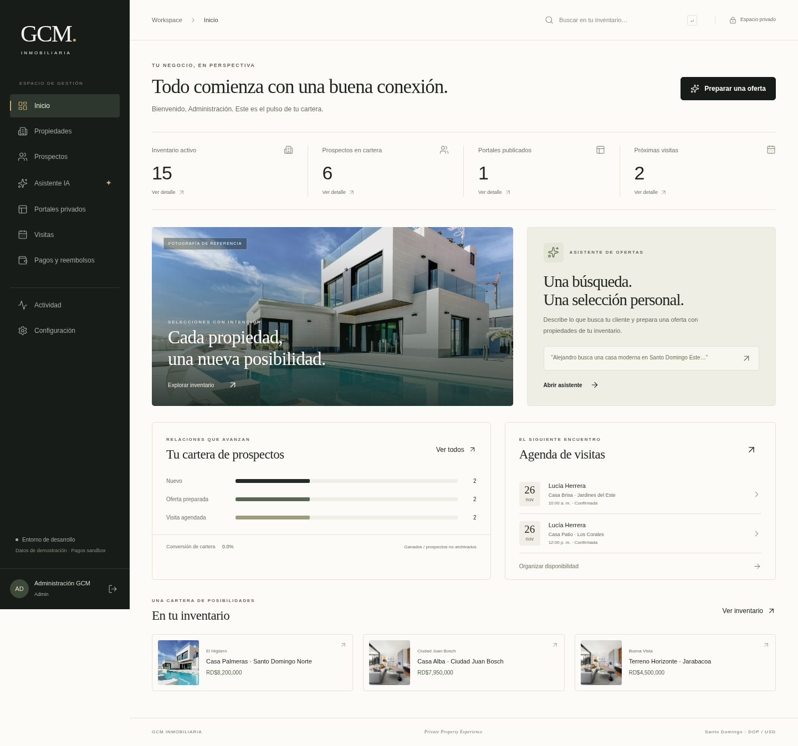

# GCM Inmobiliaria

CRM privado con inventario, prospectos, asistente conectado a servicios reales, portales privados y visitas con garantía **sandbox**. Aplicación Next.js/TypeScript y PostgreSQL, exportable sin servicios propietarios de Solid en el código de negocio.

**Estado de esta entrega:** desarrollo verificable. La IA externa está pendiente de credenciales; el modo determinista se identifica en pantalla. Los pagos son simulaciones explícitas y no mueven dinero. Exportar este código no despliega producción ni traslada la base de datos. Consulte [la matriz de alcance](docs/requisitos.md), [las evidencias](docs/verificacion.md) y [el alcance de exportación](docs/exportacion.md) antes de evaluar aceptación.



## Inicio local

Requisitos: Node 24, npm, PostgreSQL 17, herramientas cliente de PostgreSQL. `age` para copias cifradas. Chromium para la suite de navegador.

```sh
git clone https://github.com/Laleyendadelnorte/Gsminmobiliaria.git
cd Gsminmobiliaria
npm ci
cp .env.example .env.local
# Edite DATABASE_URL, APP_URL y secretos aleatorios; nunca use los placeholders.
npm run db:migrate
npm run bootstrap
ALLOW_DEMO_SEED=true npm run db:seed
npm run dev
```

Abra `http://localhost:3000` e ingrese con el administrador configurado. No existe registro público. `bootstrap` no sustituye contraseñas existentes. La recuperación operativa usa `RESET_EMAIL` y `RESET_PASSWORD` suministrados mediante un archivo de entorno privado, seguida de `npm run reset-password`; revoca las sesiones existentes. El correo automático y OTP necesitan implementación del proveedor.

El clon requiere que la publicación esté completada; mientras tanto, puede extraer el ZIP de entrega y entrar en su carpeta raíz. Frontend, API y backend arrancan juntos con `npm run dev`; en otra terminal, desde la misma carpeta, ejecute `npm run worker` para caducar reservas y sesiones. Para preparar el servidor compilado: `npm run build` y `npm start`, con HTTPS y `APP_URL` correspondiente. Las cookies seguras requieren HTTPS en producción. [Instalación completa en Windows/PowerShell](docs/windows.md), incluyendo creación de la base, variables y pruebas.

Los assets ilustrativos están incluidos. Para regenerarlos: `npm run assets` (requiere conexión). El seed es idempotente, marca los datos como ficticios y crea 15 propiedades, 5 prospectos, 3 ofertas, 21 horarios y 2 visitas sandbox. No contiene Alejandro. La base de desarrollo que acompaña la demostración puede tener registros de las pruebas; el código exportado no incluye esa base.

## Uso

1. Propiedades: crear/editar fichas, buscar, filtrar, duplicar, importar CSV con validación, subir fotografías y exportar.
2. Prospectos: perfil, preferencias, pipeline, notas y actividad relacionada.
3. Asistente: describir la búsqueda. Sin clave ejecuta un analizador determinista limitado, con escrituras reales en PostgreSQL. Con clave usa el adaptador OpenRouter; su aceptación externa aún requiere prueba.
4. Revisar borrador, ordenar propiedades y aprobar publicación. El enlace incluye un secreto en el fragmento `#token=`: compártalo únicamente con su destinatario.
5. Cliente: favoritos, comparación, interés y solicitud de visita con términos explícitos. El botón sandbox no cobra dinero.
6. Agente: confirmar asistencia y ejecutar devolución sandbox. El registro financiero y la auditoría son persistentes; no son comprobantes bancarios.

Rutas de interfaz: `/`, `/?section=propiedades`, `prospectos`, `asistente`, `portales`, `visitas`, `pagos`, `actividad`, `configuracion`; portal `/oferta/{slug}`. API en `/api/*`, salud en `/api/health`.

## Verificación

```sh
npm run lint
npm run typecheck
npm test
npm run build
```

Para integración cree una BD independiente cuyo nombre termine en `gcm_test`; configure `DATABASE_URL`, `RUN_BACKEND_INTEGRATION=true` y `AI_INTEGRATION_TEST=1`, aplique las migraciones y ejecute `npm test`. La suite de medios usa también `MEDIA_INTEGRATION_TEST=1`. Nunca use producción. Sin estas variables las pruebas de BD se omiten de forma explícita.

E2E requiere una aplicación en ejecución con seed y un enlace privado de administrador en `GCM_ACCESS_URL`, `APP_URL` y Chromium en `CHROMIUM_PATH` (default `/usr/bin/chromium`). `npm run test:e2e` realiza operaciones y devoluciones sandbox; utilice una base de demostración. La suite genera evidencias locales en `artifacts/`, excluido del repositorio. Después pueden ejecutarse `npm run test:gallery`, `npm run test:accessibility` y `npm run test:performance` con las mismas variables. Accesibilidad espera el prospecto Alejandro creado por E2E. Para el benchmark use otra BD vacía terminada en `gcm_test`, migre y ejecute `LOAD_TEST=1 npm run test:load`; crea 10k/10k/20k registros sintéticos y 100 sesiones. Elimine únicamente esa BD desechable al terminar.

## Portabilidad y operación

- [Arquitectura y esquema](docs/arquitectura.md)
- [Contrato API, autorizaciones y finanzas](docs/backend.md)
- [Asistente, confirmaciones y activación del proveedor](docs/ai.md)
- [Despliegue, DNS/TLS, servicios y copias](docs/operacion.md)
- [Seguridad y límites conocidos](docs/seguridad.md)
- [Requisitos y estado](docs/requisitos.md)
- [Pruebas ejecutadas](docs/verificacion.md)
- [Fotografías y licencias](docs/assets.md)
- [Exportación, servicios externos y variables](docs/exportacion.md)
- [Windows y PowerShell](docs/windows.md)

`Dockerfile`, `compose.yml` y CI están preparados; el informe indica cuáles se han ejecutado realmente. `.env*` reales, copias, uploads privados y capturas nuevas de `artifacts/` no se versionan. Las evidencias seleccionadas de `docs/evidence/` usan datos sintéticos. `.env.example` contiene únicamente plantillas. GitHub conserva código e historial; las bases y los objetos privados necesitan copias independientes.
