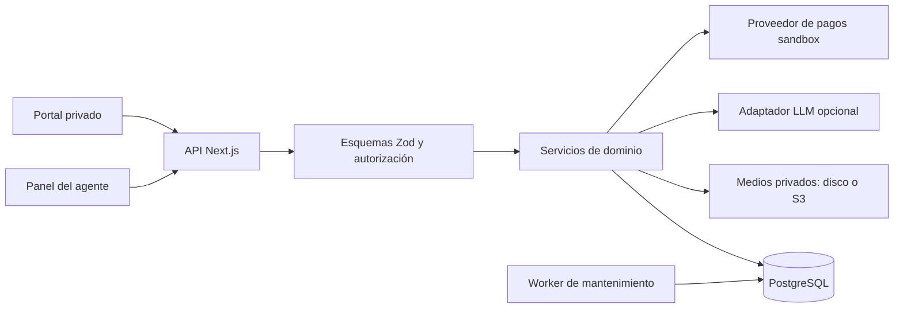

# Arquitectura y decisiones

Una aplicación multiportal comparte PostgreSQL; cada registro privado pertenece a una organización y, cuando corresponde, a un agente. Los clientes no poseen cuentas administrativas. No se crea infraestructura por prospecto.

- UI React con CSS propio y componentes accesibles: sustituye Tailwind para mantener una identidad editorial ligera sin dependencia de un kit. Tipografías del sistema; no solicitudes a fuentes externas.
- Next.js App Router y TypeScript en runtime Node. Versiones exactas y transitivas fijadas en `package.json`/`package-lock.json`; `npm ci` reproduce dependencias.
- Drizzle se inicializa sobre `pg`. El dominio utiliza SQL parametrizado y migraciones SQL explícitas, por la necesidad de locks, transacciones y ledger. No se presenta esta implementación como un modelo íntegramente generado por ORM.
- `src/server/auth.ts`: sesiones opacas, hashes, pertenencia, roles, límites de tasa y origen.
- `domain.ts`: inventario, CRM, matching, versiones/publicación y reportes.
- `ai.ts`: extracción validada, herramientas limitadas, persistencia transaccional, historial, confirmación de cambios e idempotencia.
- `portal.ts`: canje de invitación y proyección de campos públicos, favoritos e interacciones.
- `visits.ts`/`payments.ts`: concurrencia, snapshot, sandbox, verificación de eventos, ledger y devolución idempotente.
- `media.ts`: lectura acotada, validación por decodificación, originales privados y variantes sin ampliación; ledger de cuota.
- Worker persistente: caducidad de holds/sesiones y límites de tasa. Notificaciones con estado bloqueado cuando no existe proveedor. No se simula entrega de mensajes.

## Modelo relacional

`migrations/001_core.sql` es la definición autoritativa. Incluye organizaciones, usuarios, membresías, sesiones, prospectos/preferencias/notas, propiedades/medios/documentos/historial, ofertas/versiones/selecciones, invitaciones/sesiones cliente, favoritos/interacciones, horarios/visitas/historial, pagos/eventos/reembolsos/ledger, términos/aceptaciones, conversaciones/mensajes/runs IA, tareas, notificaciones, auditoría y configuración. `003_media_storage.sql` añade almacenamiento físico/cuotas; el número 002 está libre y no representa una migración perdida.

UUID, claves foráneas, índices por organización y filtros principales, códigos únicos por organización, slug único, unicidad de evento y clave de idempotencia. Todas las fechas se guardan UTC y se presentan en America/Santo_Domingo; importes enteros en unidades menores. RD$500 son 50,000. USD se mantiene separado: no existe conversión implícita.

Relaciones principales: prospecto → varias ofertas → selección de propiedades; oferta → invitaciones; visita → oferta, propiedad, prospecto, slot y términos congelados; pago → visita; reembolso y ledger → pago. Publicación y reserva usan transacciones; la ocupación de agente/propiedad se controla bajo locks. Ediciones devuelven la oferta a borrador y revocan acceso anterior. Un reembolso registrado no puede editarse: las correcciones requieren nuevos movimientos.

## Rendimiento

Listas paginadas en servidor, búsqueda parametrizada, índices, imágenes con srcset/lazy loading. Sesiones, rate limits y locks no dependen de memoria del proceso. El disco local de medios necesita volumen compartido o S3 para múltiples réplicas. IA y compresión de imágenes aún se ejecutan en solicitudes acotadas; una cola distribuida para esas tareas es trabajo pendiente. Se ejecutó el escenario sintético de lectura 10k/10k/20k con 100 sesiones: 400 respuestas válidas; ver latencias y límites en `verificacion.md`. La lista de ofertas usa cuatro consultas por página, independiente del número de resultados, y comparte la carga de galerías entre propiedades repetidas.
